# Pelotheta Θ · Básquet

**La temporada de Boca Juniors en la Liga Nacional de Básquet en datos: gráficos, tablas, situaciones y
comparaciones, cada número con su fuente y rastreable hasta el partido que lo origina.** Sistema hermano
de Pelotheta fútbol: la misma experiencia, con datos de básquet.

[](https://github.com/altamirandapatricioseb/Pelotheta-Basket-/actions/workflows/ci.yml)
[](https://github.com/altamirandapatricioseb/Pelotheta-Basket-/actions/workflows/codeql.yml)


**En vivo:** <https://pelotheta-basket-dva.vercel.app> · [English version](README.en.md)

## Qué problema resuelve

Las planillas de la LNB muestran el box score de cada partido, pero no permiten ver una estadística en el
tiempo, compararla contra el plantel ni saber cuándo un número es confiable. Pelotheta Θ junta la
temporada de Boca en un solo lugar, gratis y sin cuentas, y explica cada número: de qué fuente sale, si lo
calcula el sistema (nivel A, B o C), si es estimado y de qué partidos viene. Incluye análisis que la liga
no publica: posesiones, ratings ofensivo y defensivo, cuatro factores, quintetos, On/Off, Elo y métricas
propias.

## Funciones principales

| Interfaz | Qué hace |
|---|---|
| [Gráficos](https://pelotheta-basket-dva.vercel.app/) | 76 gráficos en 13 categorías (73 con datos), con PNG, CSV, tabla y «Ver origen» |
| [Equipo](https://pelotheta-basket-dva.vercel.app/equipo) | Boca por partido, rival, mes, competición o acumulado, 15 categorías |
| [Jugadores](https://pelotheta-basket-dva.vercel.app/jugadores) | Tabla maestra del plantel con percentiles, cada 36 y el panel del jugador, 21 categorías |
| [Situaciones](https://pelotheta-basket-dva.vercel.app/situaciones) | 118 tarjetas («cuando pasa X, ¿cómo le va a Boca?»), calculadas en SQL, 107 con casos |
| [Comparar](https://pelotheta-basket-dva.vercel.app/comparar) | Un jugador contra plantel, zona, posición u otro jugador |
| [Actualizar](https://pelotheta-basket-dva.vercel.app/actualizar) | Fecha de la última carga e historial; detecta una carga nueva sin escribir |
| Estadística desglosada | Doble clic en cualquier número: ventanas de tiempo, gráficos y partidos |

Además: libro de Excel con gráficos nativos y hojas interactivas, modelo de Power BI en estrella, una
[API de solo lectura](docs/api.md) y métricas propias (índice de rendimiento, Mejoría y Potencial α y β,
NR en cancha, On/Off, EWA, ELA y Elo).

| Claro | Oscuro |
|---|---|
| 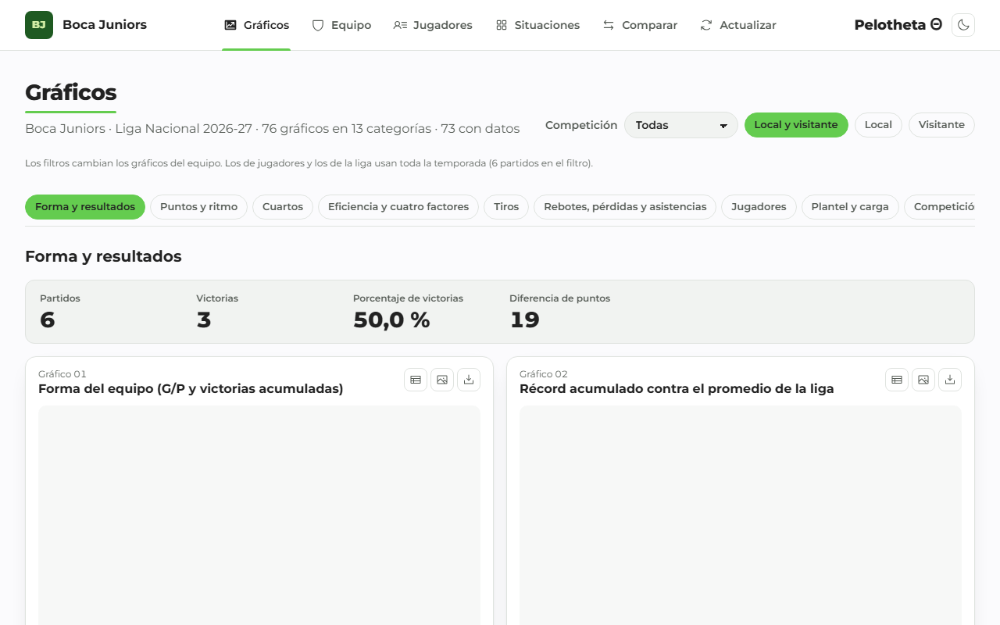 | 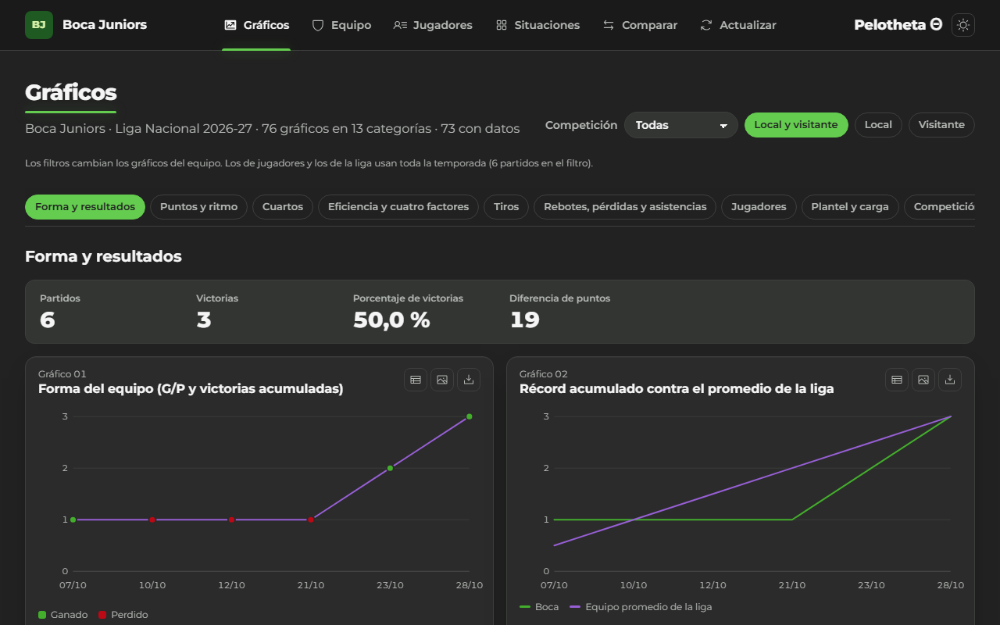 |
| 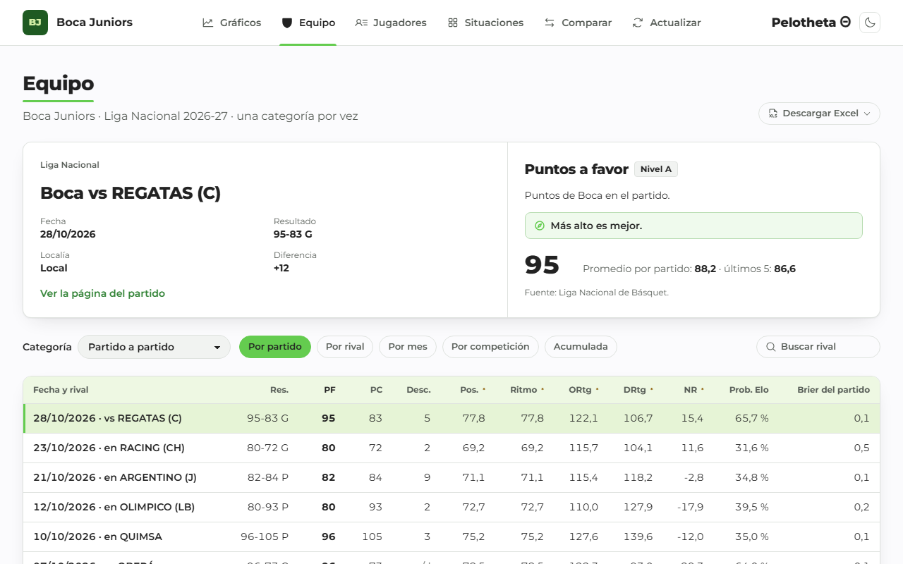 | 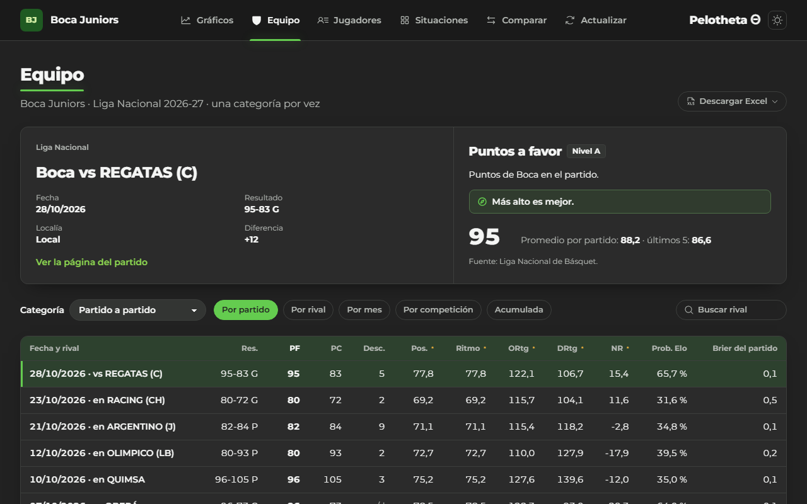 |
| 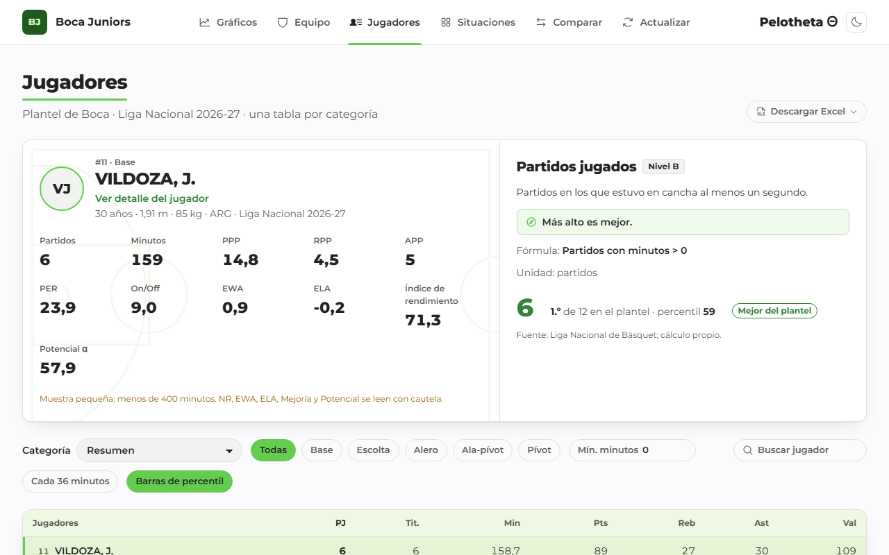 | 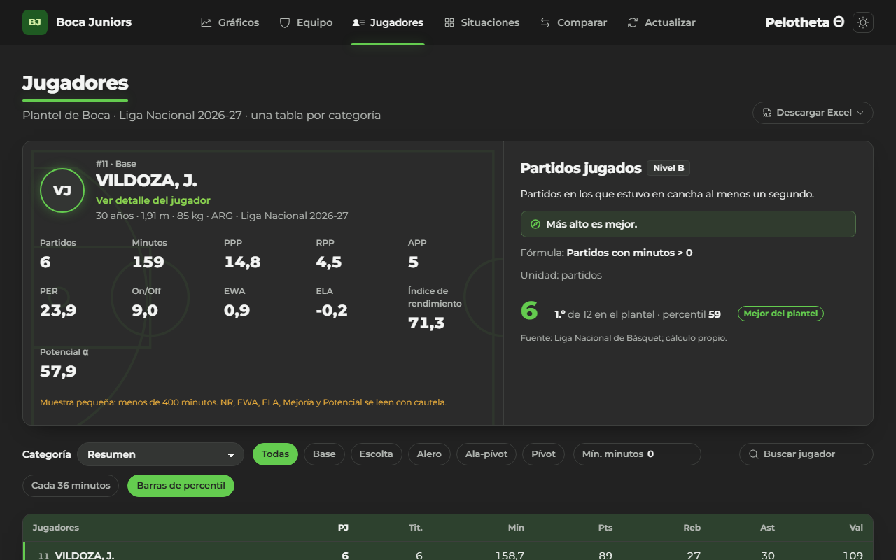 |
| 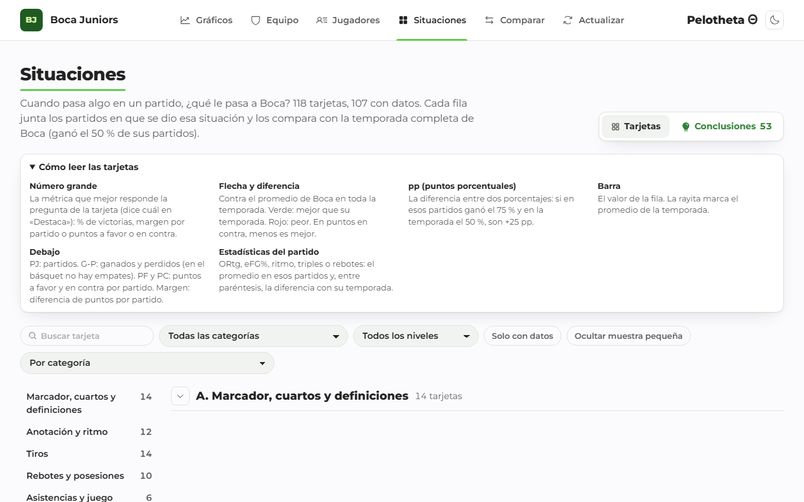 | 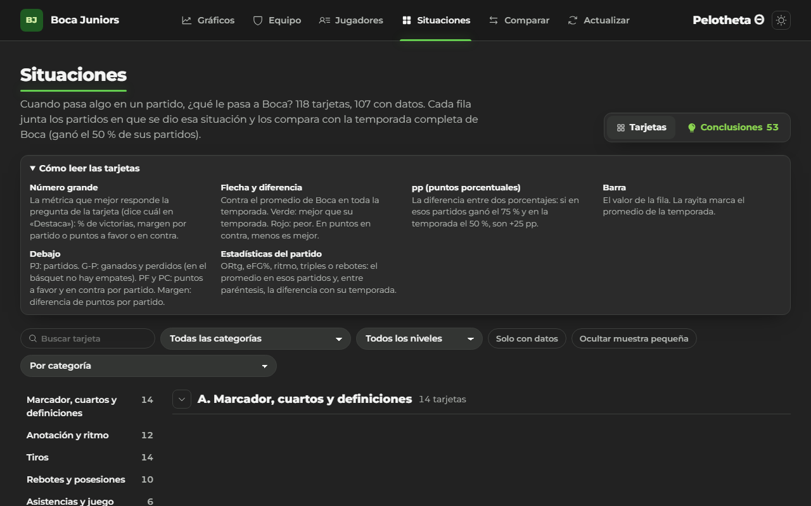 |
| 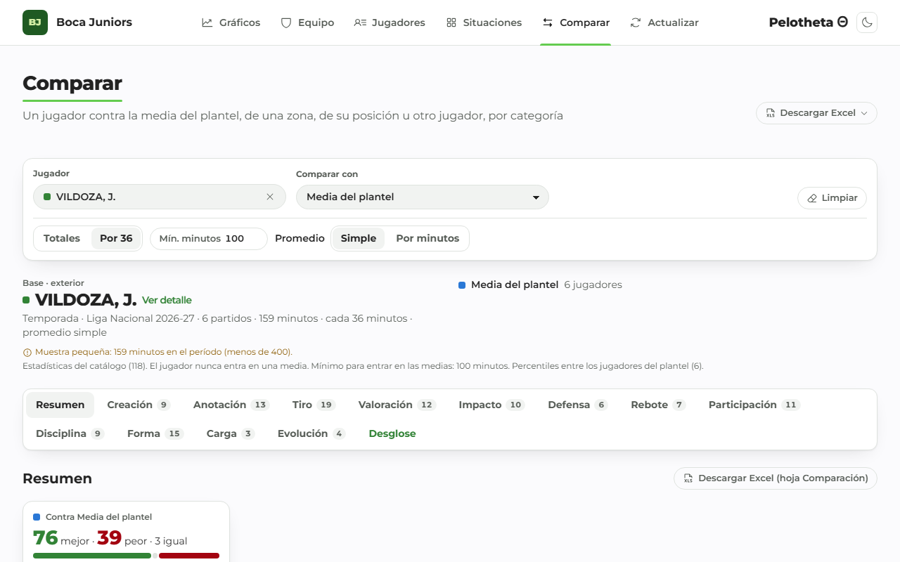 | 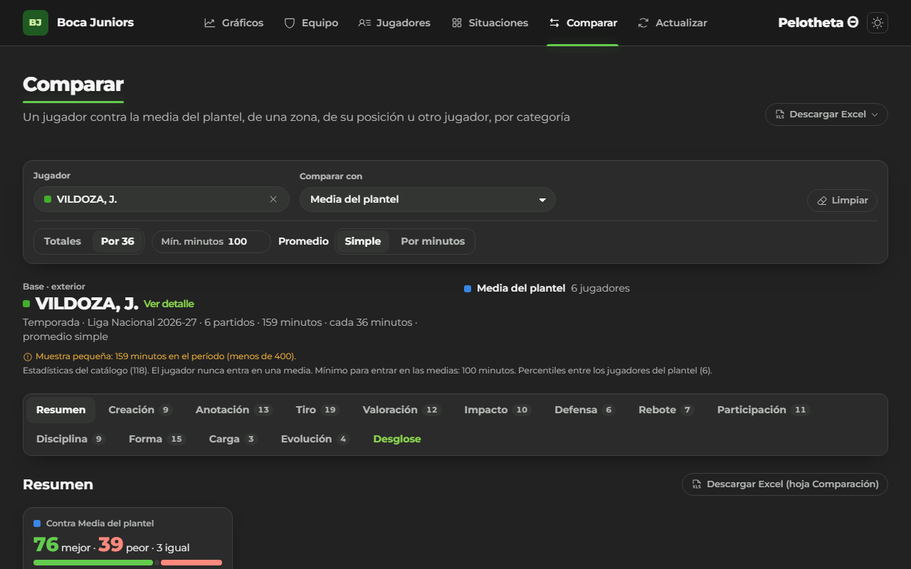 |
| 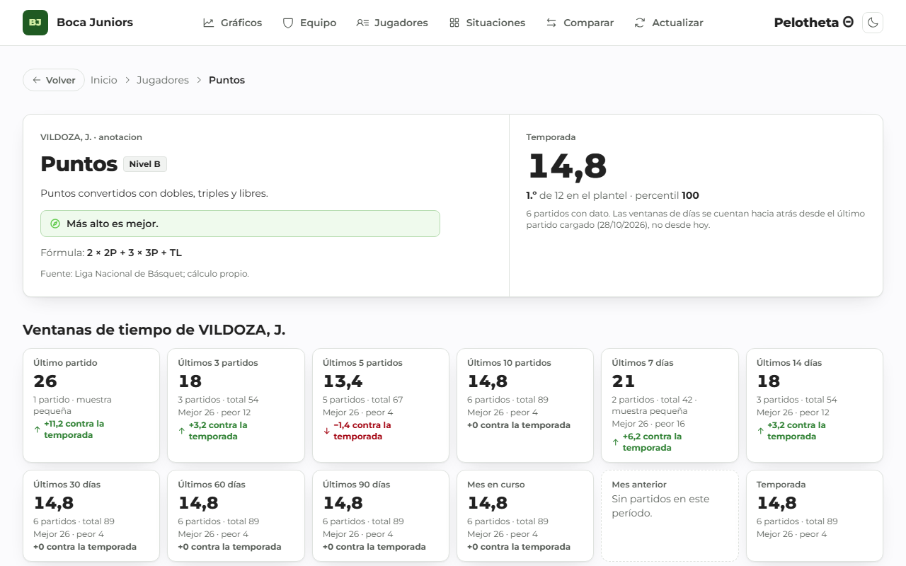 | 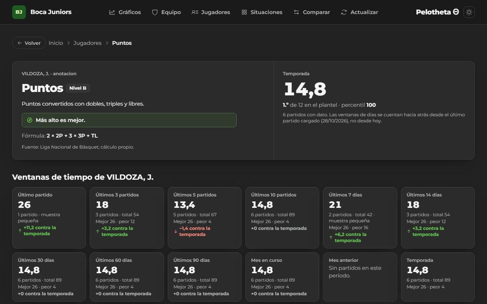 |

## Stack

**Datos:** Python 3.13 (httpx, Pydantic, xlsxwriter), uv, ruff y mypy estricto; GitHub Actions. **Base:**
Supabase (Postgres con RLS, Data API, Storage). **Web:** Next.js 16, React 19, TypeScript estricto,
Tailwind v4, Motion, Phosphor; Vitest y Playwright con axe. **Análisis:** Excel (xlsxwriter) y Power BI.

## Arquitectura

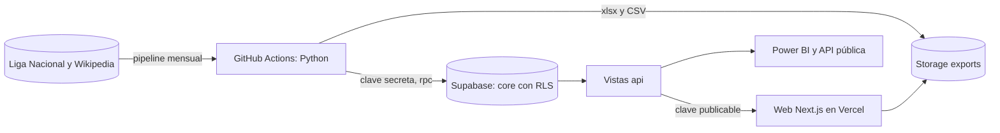

Más diagramas en [`docs/diagramas/`](docs/diagramas/).

## Inicio rápido

```bash
git clone https://github.com/altamirandapatricioseb/Pelotheta-Basket-.git && cd Pelotheta-Basket-
cp .env.example .env && cp web/.env.example web/.env.local      # completar las claves
uv sync && (cd web && corepack pnpm@10.34.9 install)            # dependencias
uv run --env-file .env python -m pipeline.run --liga && uv run --env-file .env python -m pipeline.load
just dev                                                        # http://localhost:3000
```

## Estructura del repositorio

```
sources/        adaptadores de la LNB y Wikipedia (cliente educado: pausa, robots.txt, caché)
pipeline/       validación, conciliación del play-by-play, métricas, carga, Excel y Power BI
sql/            Situaciones escritas a mano (un archivo por marco)
supabase/       migraciones y pruebas pgTAP
web/            sitio Next.js (app, components, lib, e2e)
data/           catálogos (estadísticas, conjuntos, gráficos, situaciones) y CSV de Power BI
powerbi/        medidas DAX y temas
docs/           documentación (ver abajo)
scripts/        diccionario, matriz de pruebas, PDF de entrega y backup
```

## Seguridad

Base de solo lectura para el público (RLS verificada con pgTAP 10/10), CSP con nonce, HSTS y cabeceras
estrictas, ninguna clave secreta en el repositorio (gitleaks), CodeQL, Semgrep, Dependabot, ZAP semanal,
backup cifrado mensual con restauración probada, modelo de amenazas y plan de respuesta a incidentes. Ver
[`SECURITY.md`](SECURITY.md) y [`docs/security/`](docs/security/).

## Documentación

| Tema | Documento |
|---|---|
| Producto | [Visión, personas, KPIs y hoja de ruta](docs/producto/vision.md) |
| Requisitos | [Requisitos y trazabilidad](docs/requisitos.md) · [Casos de uso](docs/casos_de_uso.md) |
| Datos | [DER](docs/diagramas/der.md) · [Diccionario](docs/diccionario_datos.md) · [Glosario](docs/glosario.md) · [Inventario de estadísticas](docs/inventario_estadisticas.md) · [Fuentes](docs/source_audit.md) · [API](docs/api.md) |
| Arquitectura | [Arquitectura, red y linaje](docs/diagramas/arquitectura.md) · [Flujos](docs/diagramas/flujos.md) · [Secuencias](docs/diagramas/secuencias.md) · [ADRs](docs/adr/) · [Red y dominio](docs/red/dominio.md) |
| Métricas | [Métricas propias](docs/metricas_propias.md) · [Fichas de modelos](docs/model_cards/) |
| Uso | [Manual de usuario](docs/manual_usuario.md) · [Power BI](docs/powerbi_guia.md) · [Soporte](docs/soporte/README.md) |
| Operación | [Manual técnico](docs/manual_tecnico.md) · [SLOs](docs/slo.md) · [Recuperación](docs/recuperacion.md) |
| Pruebas | [Plan e informe](docs/pruebas/plan_de_pruebas.md) · [Matriz de casos](docs/pruebas/matriz_casos_prueba.xlsx) |
| Gestión | [Gestión](docs/gestion/README.md) · [Gantt](docs/gestion/gantt.md) · [Informe de cierre](docs/gestion/informe_cierre.md) · [Ideas extra](docs/ideas_extra.md) · [Changelog](CHANGELOG.md) |
| Portfolio | [Caso de estudio](docs/portfolio/caso_de_estudio.md) · [Guía de entrevista](docs/portfolio/guia_entrevista.md) · [Puestos](docs/portfolio/puestos.md) |
| Entrega | [PDF único](docs/entrega/Pelotheta_documentacion.pdf) |

## Decisiones clave

- Sistema hermano de Pelotheta fútbol: se porta, no se rediseña ([ADR 0010](docs/adr/0010-sistema-hermano-de-futbol.md)).
- La LNB como fuente principal, toda la liga, y Actualizar de solo lectura ([ADR 0004](docs/adr/0004-lnb-fuente-principal-y-actualizar.md)).
- Tácticas solo de partidos cuyo play-by-play cuadra con el box score ([ADR 0009](docs/adr/0009-conciliacion-del-play-by-play.md)).
- Tablas privadas y vistas `api` de solo lectura ([ADR 0001](docs/adr/0001-esquema-privado-y-api.md)).
- CSP con nonce por request ([ADR 0003](docs/adr/0003-csp-con-nonce.md)).
- No se evaden protecciones de las fuentes ([ADR 0008](docs/adr/0008-no-evadir-protecciones-de-fuentes.md)).

## Hoja de ruta

Primera carga mensual automática con datos nuevos, página de estado como la de fútbol y, al cerrar la
temporada, calibración del Elo y validación de Mejoría y Potencial. Detalle en
[`docs/producto/vision.md`](docs/producto/vision.md).

## Licencia y fuentes

Código bajo [MIT](LICENSE). Los datos pertenecen a sus fuentes y conservan sus licencias: Liga Nacional
de Básquet (laliganacional.com.ar; se publican solo estadísticas derivadas), Wikipedia (CC BY-SA 4.0), y
SportScore y TheSportsDB para validar marcadores. Proyecto de portfolio sin fines comerciales.
