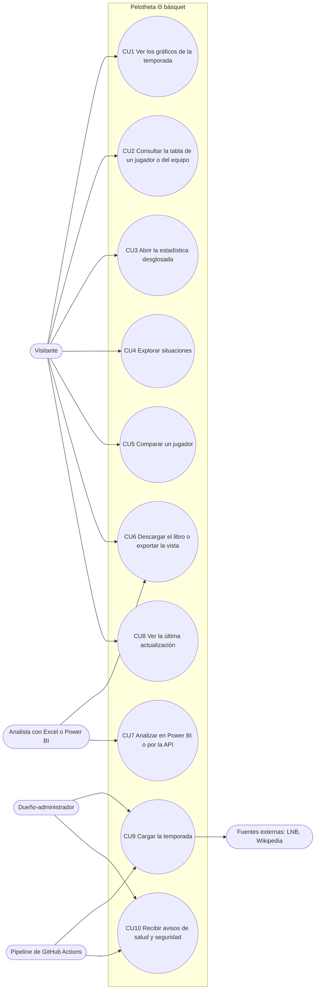

# Casos de uso

El diagrama está en Mermaid, como en Pelotheta fútbol: la sección 15 pide PlantUML solo cuando
Mermaid no alcanza, y acá alcanza y GitHub lo muestra directo.

## Especificación de los 10 principales

### CU1 Ver los gráficos de la temporada
- **Actor:** Visitante. **Precondición:** la base responde.
- **Flujo principal:** 1. Abre `/`. 2. El sistema muestra 13 categorías con números destacados y 76
  gráficos. 3. Elige filtros (competición, localía). 4. El sistema redibuja los gráficos.
- **Alternativos:** 2a. La base no responde: aviso `PEL-DB-001`. 3a. Un gráfico sin datos muestra «Sin
  datos» con el motivo.
- **Postcondición:** ninguna (solo lectura).

### CU2 Consultar la tabla de un jugador o del equipo
- **Actor:** Visitante. **Precondición:** hay partidos cargados.
- **Flujo principal:** 1. Abre `/jugadores` o `/equipo`. 2. Elige la categoría en el desplegable. 3. El
  sistema muestra una sola tabla. 4. Selecciona una fila y una columna. 5. El panel alto muestra al
  jugador y la descripción de la estadística.
- **Alternativos:** 3a. Sin minutos suficientes: aviso de muestra pequeña. 4a. Clic en un encabezado:
  ordena; el segundo clic invierte.
- **Postcondición:** el estado queda en la URL.

### CU3 Abrir la estadística desglosada
- **Actor:** Visitante. **Precondición:** la estadística tiene datos por partido.
- **Flujo principal:** 1. Doble clic (o tecla D) en una celda, un gráfico, una tarjeta o una fila de
  Comparar. 2. El sistema abre `/estadistica/<id>` con la entidad. 3. Muestra ventanas, gráficos y
  partidos. 4. «Volver» regresa al origen.
- **Alternativos:** 2a. Sin serie por partido: muestra el valor de temporada y lo dice.

### CU4 Explorar situaciones
- **Actor:** Visitante.
- **Flujo principal:** 1. Abre `/situaciones`. 2. Filtra por marco o busca. 3. Lee las conclusiones y
  las tarjetas. 4. «Ver los partidos» en una fila.
- **Alternativos:** 3a. Una fila con menos de 2 partidos no entra en las conclusiones.

### CU5 Comparar un jugador
- **Actor:** Visitante.
- **Flujo principal:** 1. Abre `/comparar` (arranca con el de más minutos contra el plantel). 2. Elige
  jugador y referencia (plantel, zona, posición u otro jugador). 3. Lee el resumen y una categoría. 4.
  Abre el desglose de una estadística.
- **Alternativos:** 2a. La referencia no se puede usar (posición sin informar): se avisa y no se usa.
- **Postcondición:** el jugador nunca entra en su propia media.

### CU6 Descargar el libro o exportar la vista
- **Actor:** Visitante o Analista.
- **Flujo principal:** 1. «Descargar Excel». 2. El sistema entrega `pelotheta-basquet.xlsx` desde el
  bucket público. 3. En el libro, elige jugadores y conjunto en el Comparador; el radar cambia.
- **Alternativos:** 1a. Exportar la vista de Comparar: el navegador arma el xlsx sin tocar el servidor.

### CU7 Analizar en Power BI o por la API
- **Actor:** Analista. **Precondición:** Power BI Desktop o un cliente HTTP.
- **Flujo principal:** 1. Baja los CSV de `exports/powerbi/` o consulta la Data API con la clave
  publicable. 2. Arma el modelo con `docs/powerbi_guia.md`.
- **Alternativos:** 1a. Conexión por PostgreSQL con `powerbi_reader` (solo lectura, cuando el dueño le
  pone contraseña).

### CU8 Ver la última actualización
- **Actor:** Visitante. **Flujo principal:** 1. Abre `/actualizar`. 2. Ve la fecha y hora en formato
  argentino y el historial de cargas. 3. Toca «Actualizar»: si hay una carga nueva, la página se
  refresca.
- **Alternativos:** 3a. Sin carga nueva: lo dice. El botón no escribe en la base.

### CU9 Cargar la temporada
- **Actor:** Pipeline (cron mensual) o Dueño (Run workflow). **Precondición:** secretos cargados.
- **Flujo principal:** 1. Baja los partidos nuevos de la LNB. 2. Valida y concilia el play-by-play. 3.
  Calcula las tablas de temporada. 4. Carga en Supabase, recalcula las situaciones y revalida la web. 5.
  Arma y sube el libro y los CSV.
- **Alternativos:** 1a. La fuente falla: se conserva lo cargado y se registra en `ingest_log`. 2a. Un
  partido no cuadra: cuarentena y tácticas en `n/d`.
- **Postcondición:** `ingest_log` con inicio, fin, filas y tamaño de la base.

### CU10 Recibir avisos de salud y seguridad
- **Actor:** Dueño, con el Pipeline de GitHub Actions.
- **Flujo principal:** 1. `health.yml` consulta `/api/health` cada 6 h. 2. `security_weekly.yml` corre
  gitleaks, auditorías, cabeceras, RLS, ZAP y accesibilidad. 3. Si algo falla, se abre un issue
  (`salud` o `security`).
- **Postcondición:** el issue queda para el triage de `docs/soporte/README.md`.
