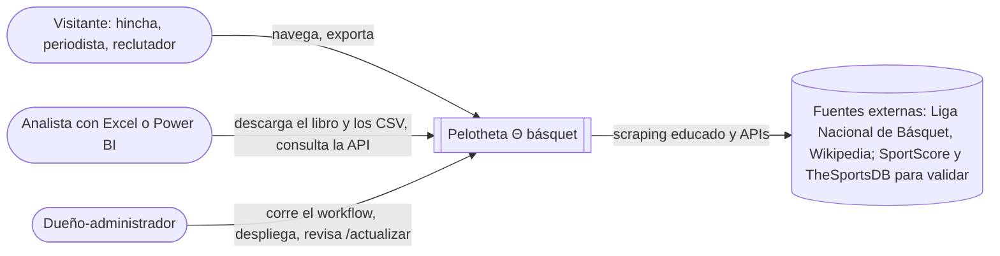
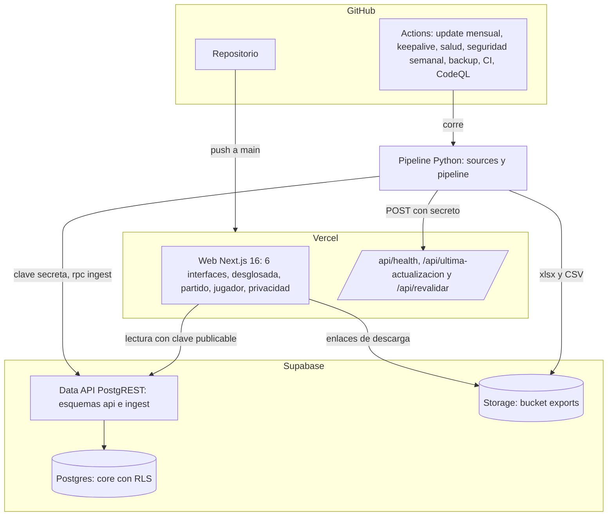
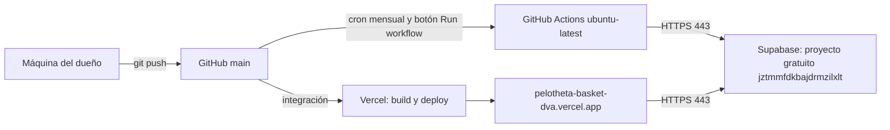
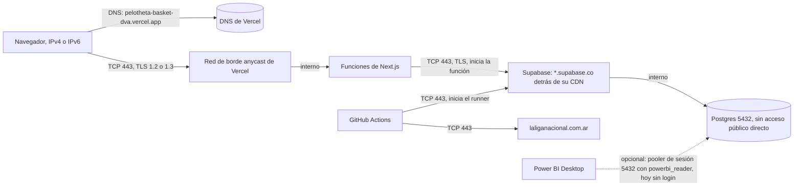
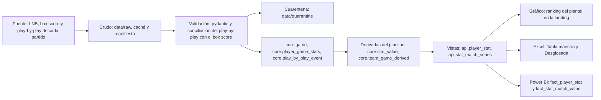

# Arquitectura, despliegue, red y linaje

La misma arquitectura que Pelotheta fútbol (sistema madre), con las fuentes del básquet.

## C4: contexto

## C4: contenedores

## Despliegue

## Red

Todas las conexiones salen del cliente hacia el servidor: ni Vercel ni Supabase abren conexiones hacia
la máquina del dueño. La conexión directa a Postgres es solo IPv6; Vercel y Actions usan IPv4, por eso
todo va por la Data API (HTTPS) o por el pooler. Dominio propio en `docs/red/dominio.md`.

## Linaje de datos

