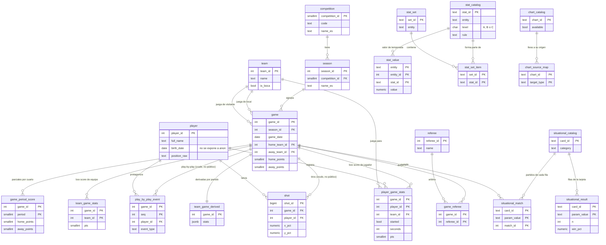
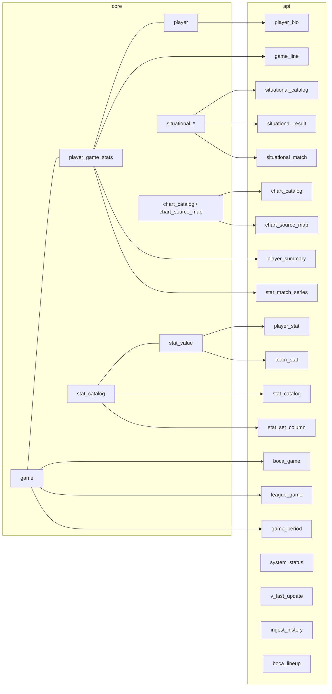
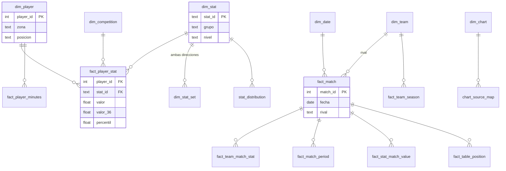

# Diagrama entidad-relación

Dos esquemas, como en Pelotheta fútbol: `core` (privado, con RLS, solo lo escribe el pipeline con la
clave secreta) y `api` (vistas `security_invoker` que lee la web con la clave publicable). Columnas
completas y tipos en `docs/diccionario_datos.md`.

## Esquema privado `core`

Tablas sin relaciones (operación): `ingest_log` (cada corrida con inicio, fin, filas y tamaño de la
base), `audit_log` (SHA del commit, tablas tocadas y hashes de entrada), `system_status`,
`source_id_map` (ids de cada fuente) y `boca_lineup` (quintetos). `situ_base` es una vista
materializada con una fila por partido de Boca, base de las Situaciones.

## Esquema público `api` (vistas)

## Modelo estrella de Power BI

`stat_correlation`, `fact_situational` y las tablas calculadas (`Eje X`, `Eje Y`, `Mínimo de
minutos`) no se relacionan: se filtran con sus propias columnas (ver `docs/powerbi_guia.md`).
