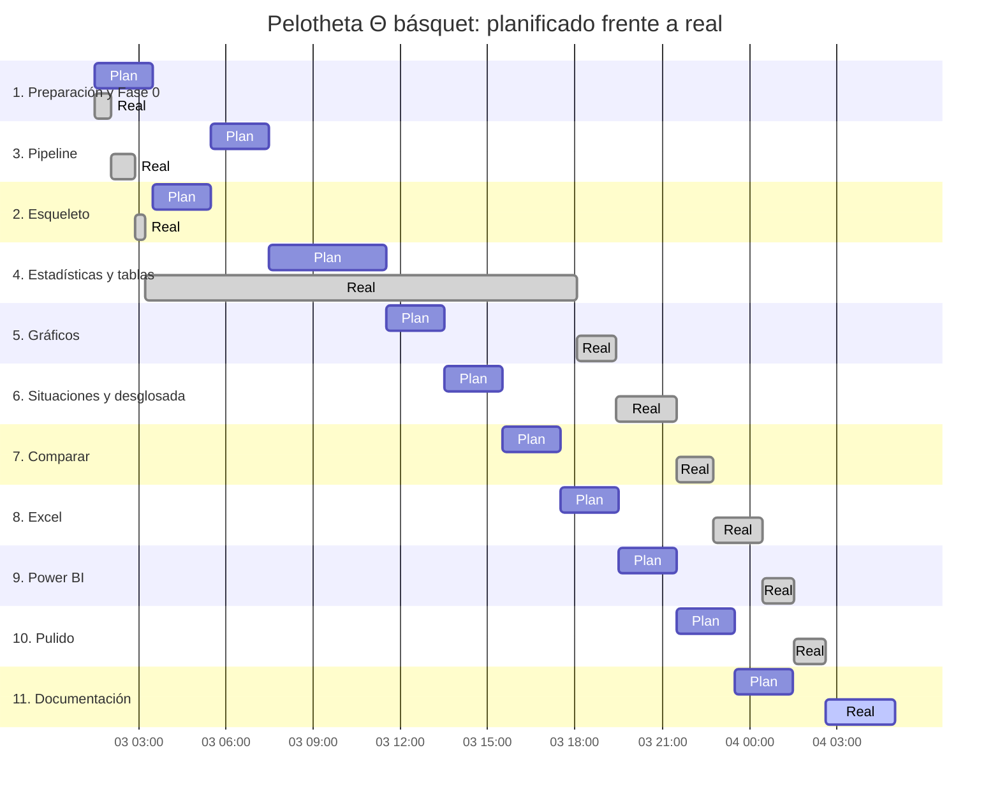

# Gantt (planificado frente a real)

El plan suponía unas 2 horas por etapa en horas seguidas; lo real sale de los commits de cierre de cada
etapa (`git log`). Datos en `gantt.csv`. Hitos: cada commit de cierre (el dueño hace el push y Vercel
despliega desde `main`).

**Desvíos.** La etapa 4 se llevó la mayor parte del día: la primera versión se rehízo para quedar igual a
Pelotheta fútbol (pedido del dueño), con el catálogo ampliado a 275 estadísticas. Las etapas 5 a 10 fueron
ports y cerraron más rápido que lo planificado; el retraso acumulado viene de la etapa 4.
