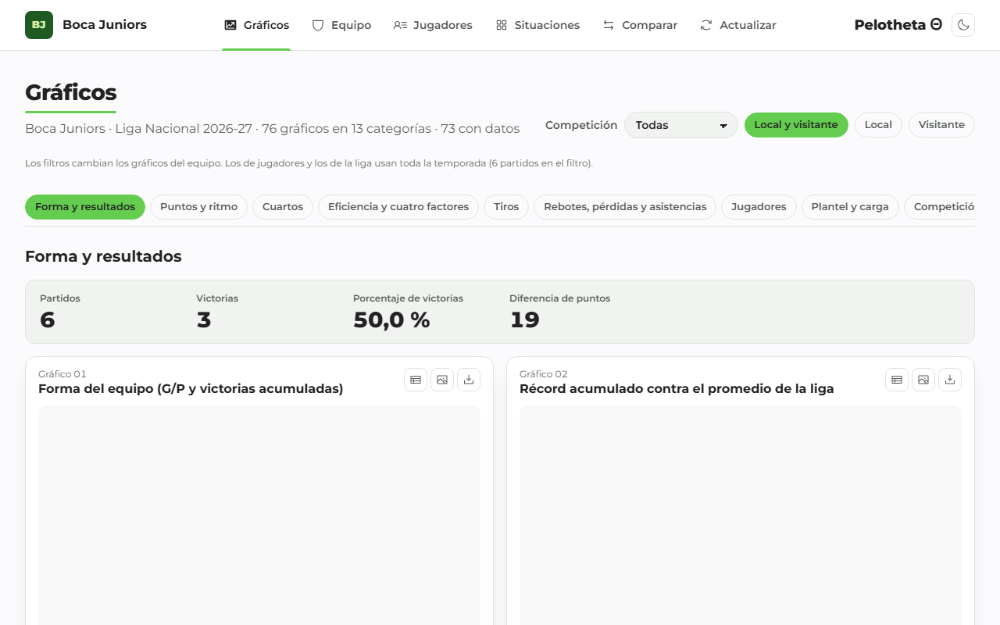
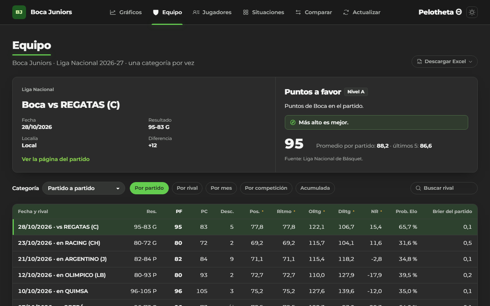
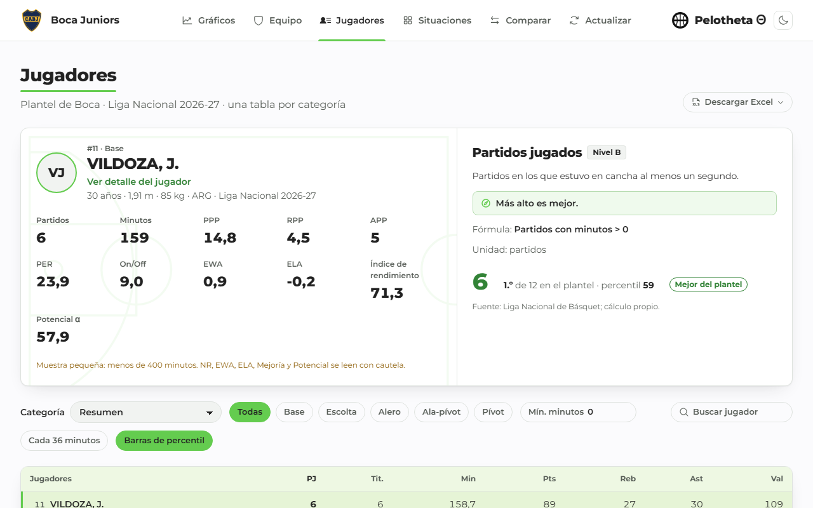
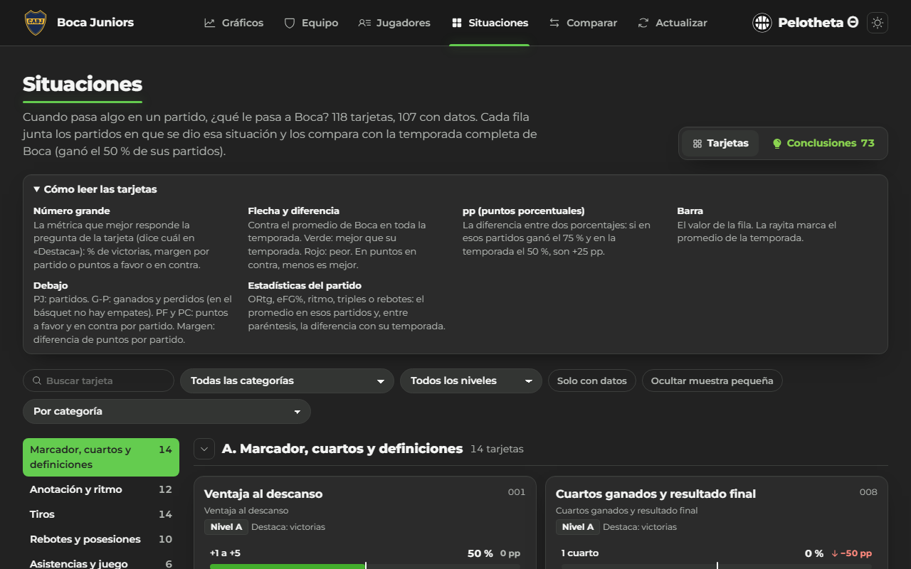
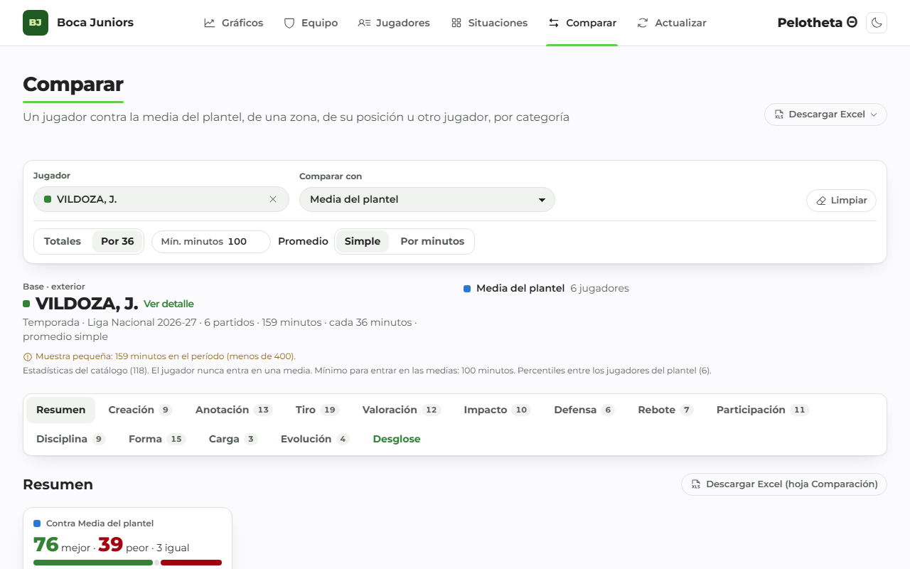
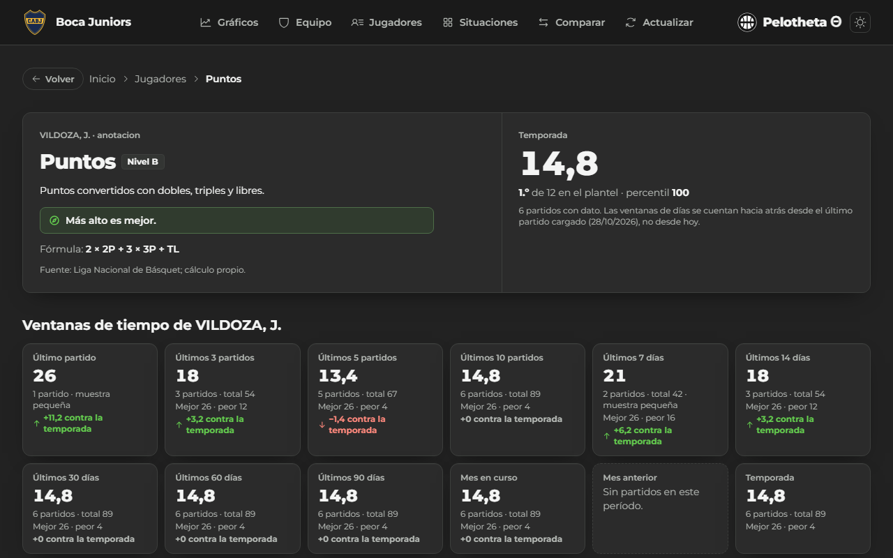

# Manual de usuario

Pelotheta Θ básquet muestra la temporada de Boca Juniors en la Liga Nacional 2026-27 en seis
interfaces, una página por estadística desglosada, una por partido y una por jugador. Dirección:
<https://pelotheta-basket-dva.vercel.app>. Funciona igual que Pelotheta fútbol. Las capturas las genera
`web/scripts/capturas.ts`.

## Lo común a todas las páginas

- **Header:** a la izquierda, Boca Juniors (lleva a Gráficos); al centro, las interfaces; a la derecha, el
  nombre del sistema (vuelve a la portada) y el botón de tema claro u oscuro. La portada y el selector de
  equipo no tienen header.
- **Frescura:** el header dice cuándo se actualizaron los datos.
- **`n/d`:** el dato no existe en la fuente o no alcanza la muestra. Nunca es cero.
- **Nivel A, B o C:** A viene de la LNB; B lo calcula el sistema; C no tiene dato. «Estimada» quiere decir
  que el cálculo usa un supuesto.
- **Estado en la dirección:** filtros, jugador y estadística quedan en la URL; se puede compartir el enlace.
- **Errores:** cada aviso trae un código estable (`PEL-DB-001`, `PEL-NF-404`; ver `docs/soporte/`).

## Portada y selector de equipo

La portada (`/`) presenta el sistema: qué fuentes entran, las 24 métricas propias y las seis interfaces
sobre una pizarra de básquet. «Elegir equipo» abre el selector (`/elegir`) en tres pasos: país, categoría
y equipo. Hoy solo se puede elegir Boca Juniors (Argentina, Liga Nacional); el resto se ve como «Sin datos
todavía». Al elegir el equipo aparecen las seis interfaces.

## Gráficos (`/graficos`)

79 gráficos en 13 categorías (76 con datos), con números destacados arriba de cada sección y una barra de
categorías que acompaña el scroll. Cada gráfico tiene «Ver como tabla», «Descargar PNG», «Descargar los
datos (CSV)» y «Ver origen de los datos». Doble clic sobre un gráfico abre la estadística desglosada.

## Equipo

Boca por partido, por rival, por mes, por competición o acumulado, una categoría por vez (15
categorías). Un clic en el encabezado ordena y otro invierte. Doble clic en el nombre de un partido abre
su página; doble clic en una celda (o la tecla D), la desglosada. «Descargar Excel» baja el libro
completo.

## Jugadores

Tabla maestra del plantel, una categoría por vez (21 categorías): al seleccionar una fila y una columna,
el panel alto muestra al jugador y la explicación de la estadística (nivel, unidad, si más es mejor,
puesto y percentil). Filtros por posición, minutos mínimos y búsqueda; «Cada 36 minutos» y «Barras de
percentil». Doble clic en el nombre abre el detalle del jugador.

## Situaciones

118 tarjetas en 10 marcos del tipo «cuando pasa X, ¿cómo le va a Boca?» (marcador y cuartos, rival,
calendario, ritmo, tiro, rebote, jugadores, rachas). Cada fila compara con la temporada completa
(verde mejor, rojo peor, siempre con el texto). «Ver los partidos» lista los partidos de la fila. Arriba,
las conclusiones del equipo y de los jugadores: las filas que se alejan de la temporada y, para cada
jugador con 36 minutos o más, su punto más fuerte y el más débil dentro del plantel.

## Comparar

Arranca con el jugador de más minutos contra la media del plantel. Se elige un jugador y con qué
compararlo: la media del plantel, de una zona (exteriores, aleros o interiores), de su posición u otro
jugador, que suma medias. El jugador nunca entra en su propia media. Resumen con mejor y peor,
fortalezas y debilidades y un radar; 12 categorías con radares, barras de diferencia, bala y tabla; y el
desglose de cada estadística. Excel y PNG.

## Estadística desglosada, partido y jugador

- **Desglosada:** una estadística de un jugador, de Boca o de un rival por ventanas de tiempo (último
  partido, últimos 3, 5 y 10, días, meses, local y visitante, por resultado), con gráficos y la lista de
  partidos. Las ventanas de días se cuentan desde el último partido cargado.
- **Partido:** marcador, cuartos, box score de los dos equipos y conclusiones.
- **Jugador:** ficha, conclusiones, todas sus estadísticas por categoría con percentil y puesto, y sus
  partidos.

## Valor

La Liga Nacional no publica sueldos ni valores de pase, así que el «precio» medible es el que paga el
entrenador: los minutos. Una regresión lineal entrenada con toda la liga dice cuántos minutos justifica
la producción de cada jugador (cada 36 minutos y edad). La tabla ordena como el resto del sistema; al
tocar un jugador se abre su pantalla con seis gráficos: aportes, paso a paso, la liga entera, comparables,
el plantel y los errores del modelo. Si se cargan valores en `data/manual/market_values.csv`, el modelo
pasa a predecir el valor en dólares.

## Alternativas

Elegí un jugador y aparecen tres listas, de la mejor opción a la peor: otro club 1 a 1, una dupla de otro
club y un compañero del plantel. Parecido = cercanía en 12 estadísticas cada 36 minutos entre todos los
jugadores de la liga con 120 minutos o más. Tocar una fila abre la comparación completa (perfil, qué se
gana y qué se pierde, dónde está la diferencia y minutos contra parecido).

## Predictor

Por defecto compara a Boca con la media de toda la zona. Con los selectores de país y liga se elige la
media de un país, de una liga o un club puntual, y dónde se juega (local, visitante o neutral). Muestra
la probabilidad de ganar, los puntos esperados, cómo puede terminar el margen y qué variable decide el
partido, más el backtest y las pruebas de hipótesis. Un club sin resultados abiertos cuenta como un club
promedio de la Liga Nacional y se marca como estimado.

## Ojeador

Informes como los de un ojeador. Arriba, la matriz de profundidad y edades: cada zona (exterior, alero, interior)
contra cinco franjas de edad, con cada jugador más violeta cuantos más minutos jugó. Después, «Lo que le falta al
plantel»: una nota de necesidad de 0 a 10 por zona (profundidad, nivel de los titulares en las estadísticas de la zona
contra la liga, titulares de 33 años o más y contratos que terminan), los motivos, lo más flojo y lo mejor de los
titulares y un mapa de calor con todos los jugadores de la zona y su percentil en cada estadística relevante, cada 36
minutos. Abajo, los informes de jugadores de otros clubes en tres categorías (por necesidad, oportunidades de mercado
y jóvenes promesas de hasta 23 años) con filtro por zona y un gráfico de nivel contra minutos por partido. Cada
informe trae nota de 0 a 10, veredicto (fichar, seguir de cerca u opción de reserva), barras violetas de nivel actual
y potencial (0 a 100), sus minutos contra la mediana de su zona y edad, en qué es bueno (verde) y en qué es flojo
(rojo). Como la LNB no publica sueldos ni pases, el «precio» son los minutos que le da su entrenador (igual que en
Valor): una oportunidad es un jugador que produce mucho con pocos minutos; con valores en dólares cargados, pasa a
ser el valor de mercado. La fuente no informa la posición de los jugadores de otros clubes: su zona se estima por su
perfil de juego (la más parecida a la de los jugadores propios) y el informe lo avisa.

«Ver informe completo» (o tocar su punto en el gráfico) abre su página: el resumen, sus minutos contra los de todos
los de su zona por edad (con la mediana, la curva de la regresión y los del plantel propio marcados), lo mejor y lo
peor de su juego y una tabla con todas las estadísticas de jugador del catálogo (las mismas que tienen los jugadores
propios): su valor, su percentil en la liga, la mediana de la liga y la de los titulares propios. Lo que la fuente
todavía no trae de otros clubes queda con «–» y se completa solo cuando llegue.

Al final, el mercado con estadística clásica, cada análisis bajo lo que muestra: cómo se reparten los minutos por
zona (diagramas de caja con media, intervalo del 95 %, mediana, desvío y coeficiente de variación, y un ANOVA de un
factor), edad y zona (tabla de contingencia con χ²), qué explica los minutos (regresión lineal múltiple por edad, edad
al cuadrado y zona, con sus curvas sobre la nube de jugadores) y el plantel contra la liga (t de Welch, F de varianzas
y z de dos proporciones).

## Análisis estadísticos de cada interfaz

Equipo, Situaciones, Partido, Jugadores, la ficha de cada jugador, Comparar (con otro jugador elegido), Valor,
Alternativas, Predictor, la Estadística desglosada y el Ojeador suman tarjetas de análisis bajo la sección de lo que
muestran (Puntos, Triples, Resultados, Local y visitante, Ritmo y eficiencia, Valoración partido a partido, Qué tan
confiable es el modelo, etc.), con los datos de esa pantalla: distribuciones (binomial, Poisson, geométrica, normal y
beta) contra lo observado con su prueba de bondad de ajuste y la regla de Sturges, gráficos Q-Q, intervalos de
confianza para medias (t de Student) y proporciones (Wilson), pruebas de hipótesis (t de Welch, F de varianzas, z de
una y dos proporciones), tablas de contingencia, ANOVA, correlación y regresión lineal simple y múltiple, el teorema
central del límite, la aproximación normal a la binomial, el diagnóstico de residuos de Valor y la inferencia bayesiana
contra la clásica en Predictor. Los puntos se modelan con la normal y los triples con la Poisson; la «calificación» de
fútbol es acá la valoración FIBA. Cada análisis dice su H₀, el estadístico, el p y la decisión con α = 0,05, y se
recalcula con cada carga de datos. Con pocos partidos (al principio de la temporada) se muestran desde 5.

## Actualizar (Interfaz 6)

Muestra la fecha y hora de la última carga en formato argentino y el historial de cargas. El botón
«Actualizar» consulta si hay una carga nueva y, si la hay, refresca la página: no escribe en la base.

## Atajos de teclado

| Atajo | Dónde | Qué hace |
|---|---|---|
| Tab y Mayúsculas + Tab | Todo el sitio | Recorre enlaces y controles; «Saltar al contenido» es el primero |
| Flechas | Tablas | Mueve la celda seleccionada |
| Enter | Tablas | Abre el partido o el jugador de la fila |
| D | Tablas | Abre la estadística desglosada de la celda |

## Exportaciones

- **Descargar Excel:** el libro completo (Equipo, Jugadores y Comparar), con gráficos nativos y hojas
  interactivas (`Comparador`, `Dispersión` y `Desglosada`).
- **Excel de la vista actual** en Comparar, con su orden y sus columnas.
- **PNG y CSV** de cada gráfico.
- **Power BI:** CSV en estrella en `exports/powerbi/` (ver `docs/powerbi_guia.md`).
- **API:** `docs/api.md` explica cómo consultar los datos directamente.

## Cómo leer las métricas propias

| Métrica | Qué dice | Cómo leerla |
|---|---|---|
| NR en cancha y On/Off | Diferencia de puntos cada 100 posesiones con el jugador en cancha, y contra cuando no está | Más alto es mejor; On/Off positivo: el equipo rinde más con él |
| EWA y ELA | Victorias que agrega en ataque (EWA) y que cuesta en defensa (ELA) frente al reemplazo | EWA alto es mejor; **ELA negativo es bueno** |
| Índice de rendimiento | Percentiles de anotación, eficiencia, rebote, creación, defensa y participación ponderados por zona | 50 es el promedio |
| Mejoría α y β | Cómo rindió en sus últimos partidos contra el resto de la temporada | **Describe** el pasado reciente |
| Potencial α y β | Hasta dónde podría llegar según nivel, edad y tendencia | Es una estimación con rango; con poca muestra se avisa |
| Elo | Fuerza del equipo, se actualiza con cada resultado de la liga | Sirve para la probabilidad previa al partido |

## Preguntas frecuentes

- **¿Por qué un dato dice `n/d`?** La LNB no lo publica, no alcanza la muestra o el partido está en
  cuarentena porque su play-by-play no cuadra con el box score.
- **¿Por qué dice «muestra pequeña»?** Con menos de 400 minutos en la temporada, los valores cambian mucho
  de un partido a otro.
- **¿Cada cuánto se actualiza?** Una vez por mes automáticamente; el dueño puede adelantarlo.
- **¿Puedo usar los datos?** Sí, para consultarlos; los datos de terceros conservan sus licencias (ver
  `/privacidad`).
- **Encontré un dato mal.** Abrí un issue con la plantilla «Dato incorrecto».
