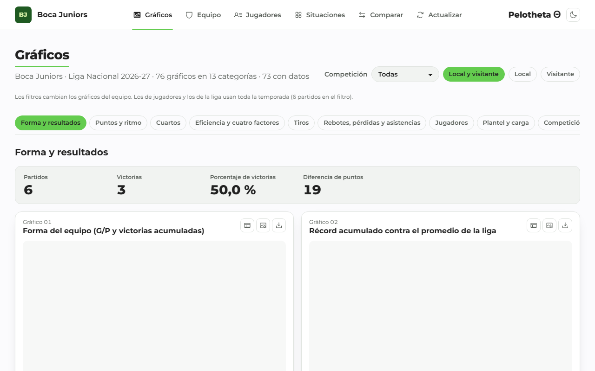
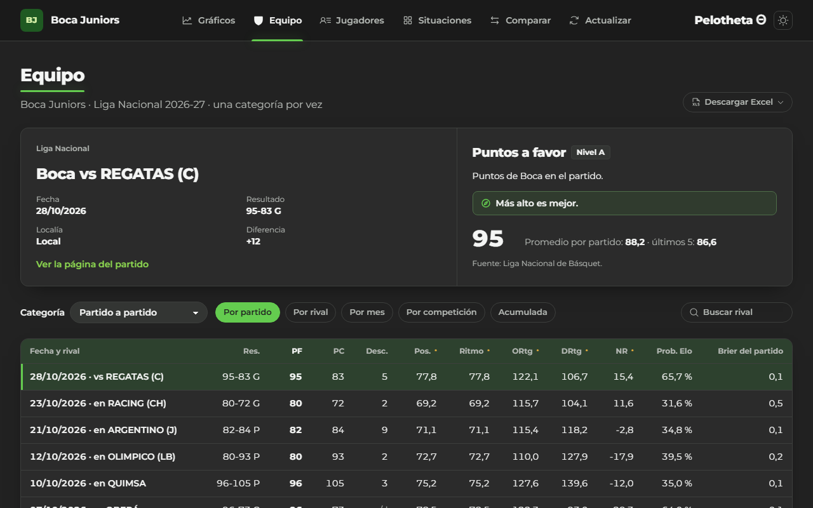
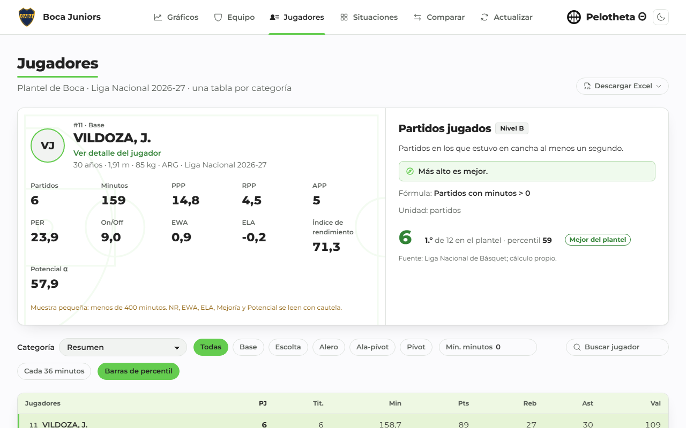
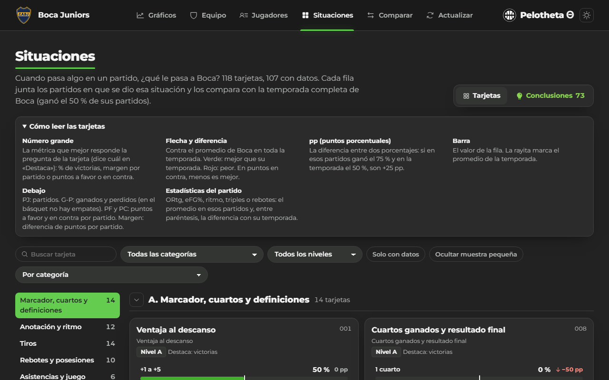
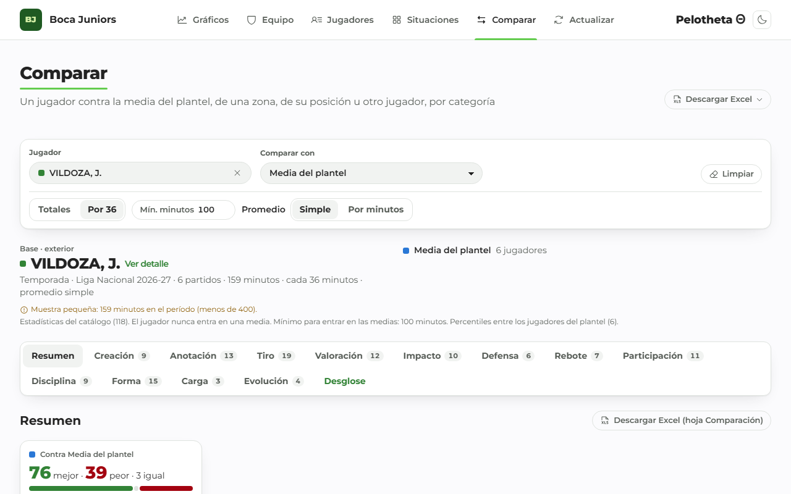
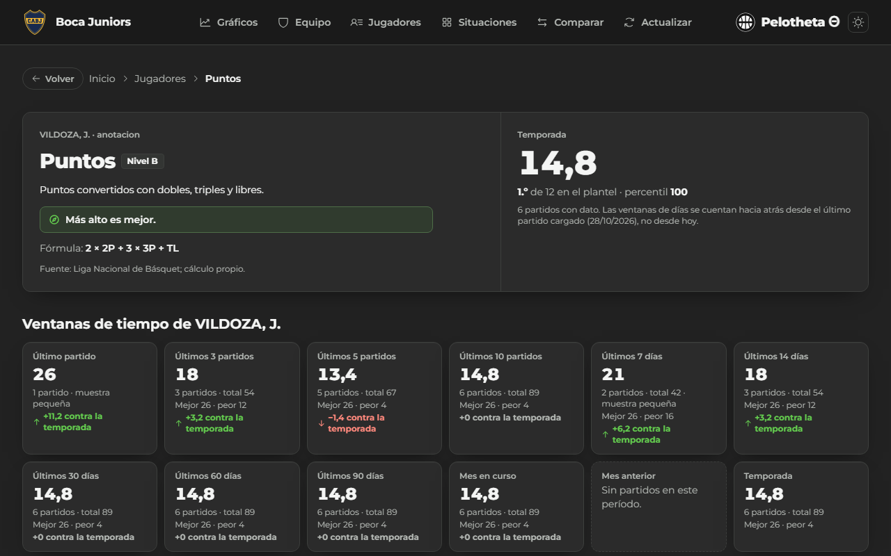

# Manual de usuario

Pelotheta Θ básquet muestra la temporada de Boca Juniors en la Liga Nacional 2026-27 en seis
interfaces, una página por estadística desglosada, una por partido y una por jugador. Dirección:
<https://pelotheta-basket-dva.vercel.app>. Funciona igual que Pelotheta fútbol. Las capturas las genera
`web/scripts/capturas.ts`.

## Lo común a todas las páginas

- **Header:** a la izquierda, Boca Juniors (vuelve al inicio); al centro, las interfaces; a la derecha, el
  nombre del sistema y el botón de tema claro u oscuro.
- **Frescura:** el header dice cuándo se actualizaron los datos.
- **`n/d`:** el dato no existe en la fuente o no alcanza la muestra. Nunca es cero.
- **Nivel A, B o C:** A viene de la LNB; B lo calcula el sistema; C no tiene dato. «Estimada» quiere decir
  que el cálculo usa un supuesto.
- **Estado en la dirección:** filtros, jugador y estadística quedan en la URL; se puede compartir el enlace.
- **Errores:** cada aviso trae un código estable (`PEL-DB-001`, `PEL-NF-404`; ver `docs/soporte/`).

## Gráficos (inicio)

76 gráficos en 13 categorías (73 con datos), con números destacados arriba de cada sección y una barra de
categorías que acompaña el scroll. Cada gráfico tiene «Ver como tabla», «Descargar PNG», «Descargar los
datos (CSV)» y «Ver origen de los datos». Doble clic sobre un gráfico abre la estadística desglosada.

## Equipo

Boca por partido, por rival, por mes, por competición o acumulado, una categoría por vez (15
categorías). Un clic en el encabezado ordena y otro invierte. Doble clic en el nombre de un partido abre
su página; doble clic en una celda (o la tecla D), la desglosada. «Descargar Excel» baja el libro
completo.

## Jugadores

Tabla maestra del plantel, una categoría por vez (21 categorías): al seleccionar una fila y una columna,
el panel alto muestra al jugador y la explicación de la estadística (nivel, unidad, si más es mejor,
puesto y percentil). Filtros por posición, minutos mínimos y búsqueda; «Cada 36 minutos» y «Barras de
percentil». Doble clic en el nombre abre el detalle del jugador.

## Situaciones

118 tarjetas en 10 marcos del tipo «cuando pasa X, ¿cómo le va a Boca?» (marcador y cuartos, rival,
calendario, ritmo, tiro, rebote, jugadores, rachas). Cada fila compara con la temporada completa
(verde mejor, rojo peor, siempre con el texto). «Ver los partidos» lista los partidos de la fila. Arriba,
las conclusiones del equipo y de los jugadores: las filas que se alejan de la temporada y, para cada
jugador con 36 minutos o más, su punto más fuerte y el más débil dentro del plantel.

## Comparar

Arranca con el jugador de más minutos contra la media del plantel. Se elige un jugador y con qué
compararlo: la media del plantel, de una zona (exteriores, aleros o interiores), de su posición u otro
jugador, que suma medias. El jugador nunca entra en su propia media. Resumen con mejor y peor,
fortalezas y debilidades y un radar; 12 categorías con radares, barras de diferencia, bala y tabla; y el
desglose de cada estadística. Excel y PNG.

## Estadística desglosada, partido y jugador

- **Desglosada:** una estadística de un jugador, de Boca o de un rival por ventanas de tiempo (último
  partido, últimos 3, 5 y 10, días, meses, local y visitante, por resultado), con gráficos y la lista de
  partidos. Las ventanas de días se cuentan desde el último partido cargado.
- **Partido:** marcador, cuartos, box score de los dos equipos y conclusiones.
- **Jugador:** ficha, conclusiones, todas sus estadísticas por categoría con percentil y puesto, y sus
  partidos.

## Actualizar (Interfaz 6)

Muestra la fecha y hora de la última carga en formato argentino y el historial de cargas. El botón
«Actualizar» consulta si hay una carga nueva y, si la hay, refresca la página: no escribe en la base.

## Atajos de teclado

| Atajo | Dónde | Qué hace |
|---|---|---|
| Tab y Mayúsculas + Tab | Todo el sitio | Recorre enlaces y controles; «Saltar al contenido» es el primero |
| Flechas | Tablas | Mueve la celda seleccionada |
| Enter | Tablas | Abre el partido o el jugador de la fila |
| D | Tablas | Abre la estadística desglosada de la celda |

## Exportaciones

- **Descargar Excel:** el libro completo (Equipo, Jugadores y Comparar), con gráficos nativos y hojas
  interactivas (`Comparador`, `Dispersión` y `Desglosada`).
- **Excel de la vista actual** en Comparar, con su orden y sus columnas.
- **PNG y CSV** de cada gráfico.
- **Power BI:** CSV en estrella en `exports/powerbi/` (ver `docs/powerbi_guia.md`).
- **API:** `docs/api.md` explica cómo consultar los datos directamente.

## Cómo leer las métricas propias

| Métrica | Qué dice | Cómo leerla |
|---|---|---|
| NR en cancha y On/Off | Diferencia de puntos cada 100 posesiones con el jugador en cancha, y contra cuando no está | Más alto es mejor; On/Off positivo: el equipo rinde más con él |
| EWA y ELA | Victorias que agrega en ataque (EWA) y que cuesta en defensa (ELA) frente al reemplazo | EWA alto es mejor; **ELA negativo es bueno** |
| Índice de rendimiento | Percentiles de anotación, eficiencia, rebote, creación, defensa y participación ponderados por zona | 50 es el promedio |
| Mejoría α y β | Cómo rindió en sus últimos partidos contra el resto de la temporada | **Describe** el pasado reciente |
| Potencial α y β | Hasta dónde podría llegar según nivel, edad y tendencia | Es una estimación con rango; con poca muestra se avisa |
| Elo | Fuerza del equipo, se actualiza con cada resultado de la liga | Sirve para la probabilidad previa al partido |

## Preguntas frecuentes

- **¿Por qué un dato dice `n/d`?** La LNB no lo publica, no alcanza la muestra o el partido está en
  cuarentena porque su play-by-play no cuadra con el box score.
- **¿Por qué dice «muestra pequeña»?** Con menos de 400 minutos en la temporada, los valores cambian mucho
  de un partido a otro.
- **¿Cada cuánto se actualiza?** Una vez por mes automáticamente; el dueño puede adelantarlo.
- **¿Puedo usar los datos?** Sí, para consultarlos; los datos de terceros conservan sus licencias (ver
  `/privacidad`).
- **Encontré un dato mal.** Abrí un issue con la plantilla «Dato incorrecto».
